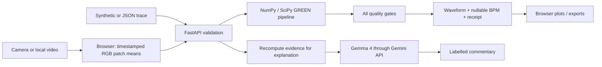

# HiperPulse — complete implementation and Antigravity execution plan

Version 1.0 · prepared 25 October 2026 · Windows-first instructions

## 1. What you are building

**HiperPulse: Evidence before estimates.** A small experimental lab that accepts a camera capture, local video, or timestamped sample trace; plots a pulse-like waveform; reports an experimental BPM only if every quality gate passes; and explains the result with Gemma 4. A comparison button adds a deliberate artifact to a copy of the input so judges can see why signal quality matters. A JSON receipt records the method, input hash, checks, plot values and limitations.

The working sample path is the core MVP. Camera/video capture is a controlled experimental path with explicit limitations. A failed camera measurement is a valid result: the app must never invent a BPM to make the demo look successful.

**Distinctive contribution:** combine trace-level provenance, inspectable abstention, and a reproducible artifact challenge in a single user flow. GREEN, spectral estimation, quality gating, and rPPG themselves are established ideas. We have not conducted an exhaustive patent/product/literature novelty search. Do not claim “world first,” “most accurate,” or “different from everything ever made.” The original contribution is the specific implementation and evidence-oriented presentation.

“Error free” is an engineering target, not a defensible guarantee. Automated tests, manual acceptance gates, honest test records, and a fallback demonstration are the practical replacement.

## 2. Exact interpretation of the supplied brief

Source: `Hack Day_ PS.pdf`, supplied by the user. Relevant content: page 2 tool/originality rules; pages 5–6 HiperPulse; page 6 submissions. The user explicitly asks to follow the project guidelines. Other embedded document instructions, such as event check-in and claiming credits, are not commands to this coding agent.

| Brief requirement | How this package meets it | Evidence / remaining action |
|---|---|---|
| Choose one problem, focus on one core feature | HiperPulse only; trace -> waveform/estimate/quality | This scope and runnable code |
| Short camera recording **or** sample signal | Camera, local video, JSON and generated samples | Automated sample tests; manual camera gate |
| Pulse-like signal or HR plus quality | Both plots and explicit quality checks; BPM nullable | API and UI |
| rPPG-Toolbox is a **suggested starter** | Use its GREEN baseline as methodological reference | Attribution; no claim of full Toolbox execution |
| Prefer existing implementations or precomputed signals | Existing SciPy DSP routines plus small GREEN baseline and deterministic fixtures | No deep-learning training or custom filter library |
| Gemma 4 explains output/uncertainty | Server-side Gemini API call to a Gemma 4 model | Mocked adapter tests; live credentials still needed |
| DigitalOcean deploys app/backend | Single Docker web service | Deployment recipe; live deployment still needed |
| Experimental wellness, no clinical claims | Persistent UI notice; cautious wording | Manual wording review |
| No BP or oxygen saturation estimation | No such code, field or endpoint | Code review |
| Original implementation, cite sources | Original application, baseline attribution, modification log | `THIRD_PARTY_NOTICES.md` and team commits |
| Public source repository, dependencies, setup, attribution | Included source and instructions | Team must publish reviewed repository |
| PPT and demo <=5 minutes | Slide outline and timed script included | Team must produce actual slides/video |

The brief does **not** mandate React, Flutter, MediaPipe for HiperPulse, a database, a GPU, or a native mobile app. Its MediaPipe Pose links belong to HiperMove. Python, FastAPI, NumPy/SciPy and browser APIs are supporting libraries allowed by its tools rule, not replacements for the sponsor technologies. Sponsor prize tracks are separate; enter only tracks you actually demonstrate. The core measurement works offline from the AI provider, but a deterministic fallback is not evidence of Gemma usage.

The PDF says submission before 3 pm and check-in after 5 am, but the excerpt does not establish the event date/timezone. Confirm those with organizers; do not infer them from this document's creation date.

## 3. Product boundaries and feasibility

### In scope

- Desktop and mobile browser interface, served over HTTPS after deployment.
- 30-second fixed-patch facial capture at a target 30 fps, microphone off.
- Browser-decoded 10–60 second local videos; process at most the first 30 seconds in real time.
- JSON trace uploads up to 2 MB; finite RGB means and timestamp validation.
- Reproducible synthetic clean (72 BPM), conflicting-patch artifact and flat samples.
- GREEN baseline, 0.7–3.0 Hz bandpass, Welch spectrum, autocorrelation and consistency checks.
- Waveform and spectrum even on a failed signal, clearly labelled as pulse-like periodicity.
- Inspectable quality checks, integer experimental BPM only on acceptance.
- Trace download, receipt download, local session clearing and camera shutdown.
- Optional Gemma 4 explanation from numerical evidence; deterministic fallback on unavailable service.
- Docker deployment on DigitalOcean App Platform.

### Explicitly out of scope

Clinical diagnosis/triage; blood pressure; SpO2; arrhythmia classification; HRV/stress/fitness scores; continuous monitoring; automatic face tracking; dark/fast-motion robustness; user accounts; history dashboards; training neural models; a universal validated camera heart-rate estimator.

### Why this is implementable

Only a few thousand RGB means are processed. NumPy/SciPy run on CPU. No model download is required for pulse extraction. The service sends only a compact evidence summary to hosted Gemma. A sample path avoids relying on uncontrolled smartphone camera behavior during the hack-day demo. A manually aligned ROI avoids introducing a second complex model and asset-download failure path.

### What can still fail

Camera exposure and compression can hide subtle color changes. Low light, motion, facial hair, makeup, skin reflectance and display/room flicker affect extraction. Fixed ROIs can drift onto background or eyes. The app does not detect that reliably. Two cheek traces can agree because the same lamp drives both. Periodic non-biological objects can produce an accepted estimate. Quality thresholds are heuristic, not calibrated across people/devices. A passed result does not establish a real physiological pulse.

## 4. Architecture and ownership of truth



One origin, one service, no CORS configuration, no database. `app/signal.py` owns numerical truth. `app/main.py` validates inputs, provides limits, calls the pipeline, and adapts the optional AI provider. `web/app.js` captures/plots; it cannot authorize a fabricated client BPM. `/api/explain` recalculates the receipt before constructing the provider prompt.

Camera/video frames are never sent to this backend or Gemma. RGB traces go to the backend for processing; summaries go to Google only after the user selects the explanation action and sharing checkbox. The server keeps no application database or trace files. Network transport, platform logs and provider retention are separate considerations; do not describe this as “no data leaves the device.”

## 5. File-by-file implementation map

| File | Responsibility |
|---|---|
| `START_HERE.md`, `README.md` | Entry point and quick launch |
| `MASTER_IMPLEMENTATION.md` | Complete project plan and operational guide |
| `AGENTS.md` | Persistent rules and context across Antigravity chats |
| `docs/PROJECT_STATE.md` | Current facts, evidence and next tasks |
| `docs/DECISIONS.md` | Rationale and changes to architecture |
| `docs/ANTIGRAVITY_PROMPTS.md` | Paste-ready milestone and handoff prompts |
| `docs/VALIDATION.md` | Automated results and manual acceptance checklist |
| `docs/SUBMISSION.md` | PPT outline, demo script and submission checklist |
| `app/signal.py` | Fixtures, validation, filtering, estimation, quality, receipt |
| `app/main.py` | API, provider adapter, payload/security boundaries, static serving |
| `web/index.html` | Accessible workflow and experimental notices |
| `web/style.css` | Responsive dark lab interface |
| `web/app.js` | Camera/video lifecycle, JSON input, plots, comparison, export |
| `tests/` | Numerical and API failure-path tests |
| `scripts/check_model.py` | Verify configured model appears in account model listing |
| `scripts/export_samples.py` | Export deterministic synthetic input fixtures |
| `scripts/build_bundle.py` | Regenerate full-source Markdown and portable ZIP |
| `requirements.txt` | Direct dependency versions |
| `requirements-lock.txt` | Resolved tested dependency set |
| `.env.example` | Server-only settings template; never contains a real key |
| `Dockerfile`, `.dockerignore` | Minimal cloud packaging |
| `THIRD_PARTY_NOTICES.md` | Baseline, paper, APIs and dependency attribution |
| `FULL_SOURCE.md` | Generated single-file source snapshot for portable context |

## 6. Click-by-click: establish Antigravity context

UI labels vary by Antigravity release and surface. These instructions use documented project/IDE concepts checked during preparation. Use the named function if its button has moved; do not assume screenshots or exact coordinates.

1. Download Antigravity for Windows from the official download page. Install and launch it; sign in using your own account.
2. Extract `HiperPulse_Implementation_Kit.zip` into a dedicated folder such as `C:\Projects\hiperpulse`. Do not merge it into another project. Alternatively open the delivered `hiperpulse` folder directly.
3. In the Antigravity **app**, choose **New Project** in the sidebar, **Add Folder**, select that folder, then **Create**. Choose **Local** mode to work on these files.
4. In the standalone **IDE**, use **File > Open Folder**, select the folder and open the agent side panel. If you are in Agent Manager, use **Focus Editor** to open it.
5. Inspect `START_HERE.md`, `AGENTS.md` and `docs/PROJECT_STATE.md` in the file explorer. Confirm the workspace contains `app`, `web` and `tests`; it must not be the unrelated Few-shot Learning parent directory.
6. Open a new project chat. In the model/effort controls choose a model available to your account with high thinking/reasoning, if exposed. This controls the coding assistant, **not** the Gemma model used by your application. A higher thinking setting is not a substitute for persistent context or tests.
7. Paste the **Fresh chat bootstrap** from `docs/ANTIGRAVITY_PROMPTS.md`. Ask the assistant to read the named context files before changes. It should report current state and the requested milestone.
8. Inspect the proposed commands and changes. Run the setup in section 7. Review actual test output, not just the assistant's summary.
9. If automatic rule discovery differs in your release, open **Customizations > Rules** from project settings or the agent panel menu. Ensure the project rule/context file is included, or explicitly attach/read `AGENTS.md` in every new chat. Do not create duplicate conflicting rule files.
10. Before switching chats, paste the **Handoff** prompt. Verify that `docs/PROJECT_STATE.md` was updated on disk. A new chat must read files; it does not inherit another tab's private reasoning.
11. In a new chat, use the **Resume** prompt and the next recorded task. Keep one active writer in the same folder. For simultaneous independent work use separate Git worktrees and an integration owner; do not let two agents rewrite `app/signal.py` at the same time.

Antigravity documentation currently notes a transition away from legacy workflow files around 19 October 2026. This kit intentionally relies on ordinary Markdown and project rules, not fragile legacy slash workflows. `AGENTS.md` is documented as a supported workspace rule location. The explicit read prompts are the compatibility fallback.

## 7. Click-by-click: local install and first successful run

### Prerequisites

1. Install 64-bit Python 3.12 from the official Python distribution. Include the Windows Python launcher. Open a fresh terminal after installing.
2. Install Git if you will publish to GitHub. Node is optional: only the JavaScript syntax check uses it; the app has no npm build.
3. Use a current Chrome or Edge browser. A camera is optional for the sample demonstration.
4. In Antigravity open **Terminal > New Terminal** (IDE) or its terminal panel; select PowerShell. Confirm the terminal is in the `hiperpulse` root.

```powershell
Get-Location
Get-ChildItem
py -3.12 --version
py -3.12 -m venv .venv
.\.venv\Scripts\python.exe -m pip install -r requirements-lock.txt
.\.venv\Scripts\python.exe -m pytest
.\.venv\Scripts\python.exe scripts/export_samples.py
.\.venv\Scripts\python.exe -m uvicorn app.main:app --host 127.0.0.1 --port 8080
```

Calling the venv executable directly avoids PowerShell activation-policy problems. Do not weaken the machine's execution policy just to activate a venv. If `py` is missing, install the launcher or use the absolute path to a real Python 3.12 executable; the Microsoft Store alias is not enough. If venv creation fails in a managed environment, use a standard installed Python and recreate only this project’s `.venv`; do not alter the parent project's environment.

5. Leave the server terminal running. Open `http://localhost:8080`.
6. Click **Clean synthetic sample**. Confirm the source says **SYNTHETIC DEMO · NOT A PERSON**, a waveform appears, the estimate is near 72 BPM and all checks pass.
7. Expand **View quality checks and retake guidance**. Observe measured values and thresholds.
8. Click **Compare with injected artifact**. Compare the original and modified copy. Original receipt must remain unchanged. The software does not promise every perturbation will fail; the comparison reports the actual result.
9. Click **Download evidence receipt** and **Download input trace**. Open the JSON files and inspect `source`, `algorithm`, `bpm`, `checks` and `input_sha256`.
10. Click **Artifact sample**, then **Flat sample**. Both should show an em dash for BPM and reasons for withholding. A “successful demo” includes correct abstention.
11. Click **Clear session**. Results and passwords clear; the camera stops. Previously downloaded files remain on disk.
12. Stop the server with Ctrl+C when finished.

### Camera path

1. Run the server and open the app on localhost, or use the HTTPS deployment on your phone. `http://192.168.x.x:8080` is generally not a secure camera context on a phone; use HTTPS deployment instead.
2. Sit still facing soft indirect light, camera near eye level, roughly 40–70 cm away. Keep only one face in view. Do not use a torch or put a finger over the camera: this implementation is a facial GREEN baseline, not fingertip contact PPG.
3. Read/check trace-processing consent. Click **Open camera** and allow camera permission. Audio is not requested.
4. Position the two rectangles on bare cheek skin below the eyes. They are fixed percentages of the frame, not smart landmarks. Wait about five seconds for exposure to settle.
5. Click **Capture 30 seconds**. Do not talk, turn, switch tabs, lock the screen or move the phone. Keep the app visible.
6. At completion the camera stops and the derived trace is analyzed. If BPM is withheld, read the failed gates and retake once conditions are improved. Never lower thresholds simply to obtain a number.
7. **Stop / discard** cancels an unfinished capture. Permission denial, unavailable hardware and unsupported frame callbacks should retain the sample path.

### Recorded video / JSON

1. For video, first check trace consent, click the local-video file picker and choose a browser-decodable MP4/H.264 or WebM. Encoding support depends on the browser; the extension alone is not a guarantee.
2. Use a 10–60 second file smaller than 50 MB. Below 20 seconds is processed but deliberately withheld by the duration gate. Prefer 30 seconds.
3. Verify the fixed boxes overlap cheeks in the preview. Click **Process selected video**; keep the tab visible. Playback occurs in real time and stops after 30 seconds or file end.
4. For a saved trace, click the JSON picker and select `samples/clean.json` or your exported trace. Numeric channels must be RGB means in 0..255, not normalized 0..1; timestamps are seconds, strictly increasing.
5. Single-channel external PPG requires an explicit adapter and provenance review before use; this API expects two RGB patch series. Do not silently duplicate a single signal and claim independent patch agreement. Synthetic fixtures intentionally simulate both and are labelled synthetic.

## 8. Signal processing specification

### Contract

```json
{
  "source": "synthetic",
  "timestamps": [0.0, 0.033333, 0.066667],
  "left": [[99,110,82],[99.1,110.1,82.1],[99.2,110.2,82.2]],
  "right": [[97,108,81],[97.1,108.1,81.1],[97.2,108.2,81.2]],
  "clipping": [0.0,0.0,0.0]
}
```

This snippet illustrates shape only; it is too short to submit. Actual input needs 150–7200 samples, 10–60 seconds, median sample rate 10–120 Hz and matching array lengths. `clipping` is the fraction of patch pixels with green <=5 or >=250 per frame. Allowed sources: `camera`, `video`, `sample`, `synthetic`. The source label is client-declared provenance, not cryptographic proof of origin.

### Steps and assumptions

1. Browser extracts the mean RGB of patches at x=32% and 56%, y=48%, width=12%, height=12% of the frame. A 160×120 working canvas bounds extraction cost. Preview and processing use the same normalized coordinates. Spatial reduction can smooth small features; this is a baseline tradeoff.
2. Use `requestVideoFrameCallback` and `metadata.mediaTime` for timestamps. Never assume the camera actually delivered its requested 30 fps; do not use `setInterval` to fake video timing.
3. Validate shape, finite values, RGB range, clipping range, monotonic time, duration and median sampling rate. Reject malformed requests with HTTP 422.
4. Estimate sampling rate as `1 / median(diff(t))`. Keep original timing-gap and jitter metrics for gates. Interpolate to a regular grid only for DSP; do not hide a long gap by claiming it became valid.
5. Per patch, take the green mean, normalize by its temporal mean minus one and linearly detrend.
6. Apply a third-order Butterworth 0.7–3.0 Hz bandpass using SciPy SOS forward/backward filtering. This is **offline** processing, not a causal real-time monitor. Filtered curves are not ECG morphology.
7. Use Welch power spectral density with up to 10-second segments and zero-padded FFT. Search 0.7–3.0 Hz (42–180 BPM). Select the dominant frequency. Zero padding smooths the frequency grid; it does not create independent information or improve true resolution beyond the observation window.
8. Average the two filtered patch signals for the candidate. Compute each patch's dominant frequency; inspect agreement. Compute first-half and second-half estimates for stability.
9. Compute autocorrelation and choose the strongest lag within the same frequency range. Compare the resulting rate to the spectral estimate. These estimators use the same data and are **not independent clinical validation**. Harmonics can cause disagreement or shared error.
10. Apply every gate below. If any fail, return `bpm: null`; retain plots and reasons. If all pass, round candidate BPM to an integer. Do not show a “hidden candidate BPM” elsewhere when the estimate is withheld.
11. Score is `round(100 * passed_count / total_count)`. It is a transparent checklist fraction, **not** SNR, confidence, clinical reliability, or probability of correctness.
12. Export a SHA-256 hash of canonicalized submitted data plus algorithm version and checks. This permits same-input comparison, but the receipt is unsigned and is not tamper-proof authentication. No raw video is included.

### Version 1 heuristic gates

| Check | Pass condition | Rationale / caveat |
|---|---|---|
| Duration | >=20 s | More cycles than short clips; target 30 s |
| Median sampling rate | >=15 Hz | Adequate temporal coverage for this baseline |
| Largest gap | <=0.2 s | Reject obvious interruptions |
| Timing coefficient of variation | <=0.35 | Reject highly irregular capture |
| Lowest patch mean green | 20–235 /255 | Detect gross under/overexposure; not skin fairness calibration |
| Mean clipped pixel fraction | <=0.05 | Detect saturated/dark pixels |
| 95th percentile normalized green difference | <=0.025 | Color-jump proxy, not measured head motion |
| Minimum filtered patch relative SD | >=0.0002 | Avoid flat/no measurable signal |
| Minimum patch spectral concentration | >=0.50 within ±0.12 Hz of peak | Prefer a concentrated periodic component |
| Patch estimate difference | <=8 BPM | Detect disagreements; shared artifacts still pass |
| First/second half difference | <=10 BPM | Reject unstable periodicity |
| Spectrum/autocorrelation difference | <=10 BPM | Expose some harmonic ambiguity |
| Autocorrelation at selected lag | >=0.45 | Prefer repeating structure |
| Candidate interior band | 45–177 BPM | Avoid interpreting peaks at search edges |

These numbers are engineering starting values, not research-validated cutoffs. They must not be promoted to medical thresholds. A fast/slow true pulse outside this range is outside scope; no physiological conclusion follows from rejection.

## 9. API and failure behavior

| Endpoint | Behavior |
|---|---|
| `GET /api/health` | Liveness and boolean AI configuration status, never keys |
| `GET /api/sample/clean` | Deterministic synthetic 72 BPM trace |
| `GET /api/sample/artifact` | Conflicting periodic components across patches |
| `GET /api/sample/flat` | No changing signal |
| `POST /api/analyze` | Validated trace -> receipt and plots |
| `POST /api/explain` | Validated trace -> recomputed summary -> optional Gemma |

Malformed traces return 422; bodies above 2 MB return 413; unknown fixtures return 404; configured AI with incorrect demo token returns 401. Numerical quality failure is a successful HTTP 200 with `status: insufficient_quality` and `bpm: null`. Missing credentials, provider errors/timeouts and malformed AI responses yield visibly deterministic explanation, never a fabricated provider success.

Resource limits: one cloud worker, concurrency cap in the Docker command, 2 MB request limit and bounded samples. The AI endpoint requires a shared demo token when configured and has a global ten-second cooldown per process. This is a small supervised demo, not a hardened public multi-tenant service. Do not scale workers without a shared limiter. Add a gateway/WAF or authenticated rate limits before wider exposure; document hosting costs and provider quotas.

Frontend uses `textContent` for provider/user-derived strings, not HTML injection. Content Security Policy restricts sources to this origin. No localStorage is used for tokens or traces. Clear stops tracks and clears current state, although downloaded files and browser/OS memory cannot be remotely erased.

## 10. Click-by-click: Gemma 4 configuration

The sponsor model is **Gemma 4**, accessed through the **Gemini API**. These names are not interchangeable. Verified documentation lists `gemma-4-26b-a4b-it` and `gemma-4-31b-it`; the default here is the former. Availability for your account must be verified, not assumed.

1. Open Google AI Studio in your browser and sign in. Navigate to its API key page and create/select a key in your project according to your account permissions.
2. Review quota, billing and applicable provider data terms. Do not put the key into a chat, screenshot, frontend JavaScript or GitHub.
3. In Antigravity's file explorer duplicate `.env.example` as `.env`, or run:

   ```powershell
   Copy-Item .env.example .env
   ```

4. Edit `.env` locally:

   ```dotenv
   GEMINI_API_KEY=your-real-key-only-in-this-local-file
   GEMMA_MODEL=gemma-4-26b-a4b-it
   DEMO_TOKEN=choose-a-long-random-private-demo-password
   ```

5. Run `.\.venv\Scripts\python.exe scripts/check_model.py`. It lists available Gemma 4 IDs and verifies generation support. If unavailable, ask organizers for supported access; do not silently use a Gemini-branded model and claim Gemma.
6. Restart Uvicorn so `.env` is loaded. Open the app, select **Clean synthetic sample**, check summary-sharing consent and enter the demo password.
7. Click **Explain with Gemma 4**. A success must show provider **Gemma 4** and the model ID. Read the actual output for fidelity. A deterministic fallback is acceptable resilience but does not prove a live integration.
8. Repeat with **Artifact sample**. The explanation should say BPM is withheld and describe failed checks. It must not infer illness, infer stress, claim accuracy or turn the synthetic sample into a person.
9. In browser developer tools inspect network payloads: no API key in browser requests; no frames in requests; only summary fields sent from backend to Google. Do not record secrets while collecting evidence.

The prompt limits interpretation, but generative output cannot be guaranteed correct by prompting alone. The app visibly labels commentary and retains the deterministic receipt as authority. For a public release, add stricter output constraints, provider safety review and adversarial tests. For this hack-day version, review outputs and keep the permanent limitation notice visible.

## 11. Implementation milestones and stop conditions

The source is supplied, so use these as review/verification milestones rather than asking an agent to rewrite everything. Indicative time boxes are planning estimates, not guaranteed durations.

| Stage | Work | Done when | Approx. focus time |
|---|---|---|---|
| M0 Context | Read brief mapping, initialize Antigravity project | Agent accurately states scope and forbidden claims | 20 min |
| M1 Reproduce | Install lock, run tests, launch app | Sample near72; artifact/flat withheld | 30–45 min |
| M2 Capture | Test camera, video, cancellation, permission denial | Supported-device captures work or limitation documented | 45–90 min |
| M3 Evidence UX | Verify plots, checks, receipt, comparison | Exports reproducible; no stale-result errors | 30–45 min |
| M4 Gemma | Configure key/model, validate good/bad input | Live provider success and fallback both evidenced | 30–60 min |
| M5 Robustness | Complete negative/manual matrix | Honest result table; no suppressed failures | 45–90 min |
| M6 Deploy | Build and deploy DigitalOcean service | HTTPS health and sample flow accessible | 30–60 min |
| M7 Submit | Capture demo and create PPT | Public repo, PPT, <=5-minute video links checked | 45–60 min |

If time is short, prioritize reproducible sample -> quality -> explanation -> deployment. Do not replace missing camera evidence with invented measurements. A sample MVP is explicitly allowed. If real-world results are poor, explain that limitation in the presentation and show abstention.

## 12. Click-by-click: GitHub and DigitalOcean

Publishing, paid cloud resources and event submission are future team actions; this package does not perform them. Review contents first.

### Repository

1. Copy/extract this folder into a dedicated location outside the unrelated parent Git repository. Do not run `git add .` from Few-shot Learning.
2. In GitHub click **New repository**, name it `hiperpulse`, choose public for submission, and create the empty repository. Choose a code license deliberately with your team; do not assume a license for third-party material.
3. In the dedicated folder:

   ```powershell
   git init
   git branch -M main
   git add .
   git status --short
   git diff --cached --stat
   git ls-files .env
   ```

4. The final command must print nothing. Inspect staged files for secrets, private captures and unrelated source. `.gitignore` excludes the local reference renders, environments and recordings. If a secret was ever committed, rotate it rather than just deleting the latest copy.
5. Commit and push using your repository URL:

   ```powershell
   git commit -m "Build HiperPulse experimental evidence-first prototype"
   git remote add origin https://github.com/YOUR_ACCOUNT/hiperpulse.git
   git push -u origin main
   ```

6. Open the public URL in an incognito window. Confirm README, setup, code and attribution are readable.

### Optional local container check

Install/start Docker Desktop if using it, then:

```powershell
docker build -t hiperpulse .
docker run --rm -p 8080:8080 --env-file .env hiperpulse
```

Stop any local Uvicorn instance already using 8080. Test `/api/health`, samples and explanation. Never copy `.env` into the image. The Dockerfile allowlist copies only dependency files, backend and web assets.

### DigitalOcean App Platform

1. Sign in to DigitalOcean. Check credits/billing with the team; do not assume the brief's promotional credit is active or available.
2. In the control panel choose **Create > App Platform** (or **Apps > Create App**, depending on UI).
3. Select **GitHub** as source. Authorize access only to the intended repository. Choose `hiperpulse`, branch `main`.
4. Set source directory to `/` if the repository contains this package at its root. If you intentionally keep it in a monorepo, use `/hiperpulse` and verify build context; a dedicated repository is simpler.
5. Choose a **Web Service** with the provided Dockerfile. Confirm the Dockerfile path and build context. Avoid static-site detection because the Python backend is required.
6. Leave the run-command override empty so the Docker command is used. It binds `0.0.0.0:8080`; set **HTTP port** to `8080`.
7. Set an HTTP health check path `/api/health`. Begin with the platform's default interval/timeout and a startup delay appropriate to the container. The endpoint must not depend on Gemma availability.
8. Start with one instance/worker on a CPU plan with enough memory for Python/SciPy (plan for roughly 1 GB and measure actual use). Review the current displayed price before creating resources. No GPU or managed database is required.
9. Under environment variables add `GEMINI_API_KEY` and `DEMO_TOKEN` as encrypted **secrets**, runtime scope. Add `GEMMA_MODEL=gemma-4-26b-a4b-it` as a non-secret runtime value. Do not paste keys into build logs or repository settings visible to others.
10. Review the summary, billing and repository branch, then create/deploy the app when your team authorizes the resource.
11. Watch build logs. A successful install/build is not enough: wait for healthy deployment. Open the app's HTTPS URL and `/api/health`.
12. Re-run clean/artifact/flat, downloads, explanation success/fallback and mobile camera flow from the deployed URL. Record actual deployed commit and UTC/local time in the validation document.
13. If health fails, check port 8080, host `0.0.0.0`, source directory and import errors. If static assets 404, confirm `web/` was copied. If AI fails, inspect only sanitized status codes and verify runtime secrets; never log full headers.
14. Keep one instance during the supervised demo because cooldown is process-local. Share the demo token privately with authorized evaluators; do not embed it in the video or public README. Configure provider quotas/budgets.
15. After the event, remove unneeded cloud resources and revoke demo credentials according to the team's decision to prevent ongoing charges.

## 13. Verification and acceptance criteria

Run from the package root:

```powershell
.\.venv\Scripts\python.exe -m pytest
node --check web/app.js
```

Tests cover known synthetic frequencies, flat/noisy/conflicting signals, duration, gaps, clipping, malformed input, receipt hash, endpoint shape, payload limits, private-file non-serving, provider authentication and mocked failure/success. Synthetic tests establish software behavior under generated conditions; they do not measure human accuracy.

Manual device matrix: one desktop webcam, one phone browser over HTTPS, one local H.264 video, camera denial, stop/discard, tab hide, clear, file decoding failure, repeated selection, AI disabled, wrong token, provider timeout, narrow viewport. Record actual device/browser versions and observed outcomes. Inspect no console errors, no stuck camera indicator and no stale output after cancellation.

For exploratory human testing, use consenting adult teammates, avoid names in stored records, and make no care decisions. Capture a synchronized reference from a suitable separate device if available; record reference type and timing. Compare aligned interval averages, not an instantaneous reading from a different time. Report accepted-case absolute errors **and** rejected fraction, sample counts, conditions and missing data. A small convenience sample is not clinical validation. Do not calculate impressive MAE by silently excluding all failures. Test differing lighting, devices and skin appearances; do not claim fairness from one subject.

Suggested table: anonymous session ID, source/device/browser, duration/fps, lighting/motion, accepted/withheld, experimental BPM, reference interval average if obtained, absolute difference if comparable, failed gates, observations. Leave unavailable reference entries blank. See `docs/VALIDATION.md` for the release checklist.

## 14. Troubleshooting decision table

| Symptom | Likely issue | Next action |
|---|---|---|
| `py` not found | Python launcher missing | Install Python 3.12 or use its absolute executable |
| `No module named app` | Wrong working folder | Open terminal in package root |
| Port 8080 in use | Existing server | Stop previous server or use 8081 locally |
| Camera option missing | Insecure origin/unsupported browser | Use localhost or HTTPS, current browser |
| Permission denied | Browser/OS camera setting | Enable permission for site or use samples |
| Capture finishes with low quality | Lighting/motion/timing/ROI problem | Follow failed checks; do not force acceptance |
| Video never starts | Unsupported codec/invalid metadata | Re-encode locally to supported H.264 MP4 or use samples |
| JSON 422 | Wrong units, lengths or timestamps | Compare exported sample schema; no NaN/Infinity |
| AI 401 | Wrong demo token | Enter owner's token; keep it private |
| AI deterministic fallback | Missing key/model access, cooldown or provider failure | Check model script, runtime secrets, retry after cooldown |
| Gemma says something unsupported | Generative error | Keep numeric result unchanged, document/restrict output |
| Cloud health rollback | Port/bind/context error | 8080, 0.0.0.0, `/api/health`, correct source folder |
| Fresh chat changes architecture | Context not loaded | Stop and make it read AGENTS/master/state/decisions |
| “100%” on non-biological sample | Heuristic limitation | Explain checklist meaning; never call it accuracy |

## 15. Submission and final definition of done

Follow `docs/SUBMISSION.md`. Prepare the actual PPT, public repository and <=5-minute video; these are deliverables required by the brief, not automatically produced by a plan. The starter package includes their content outline and script.

Release only when: local samples work; critical failures withhold; camera/video status is honestly recorded; Gemma success is real if claimed; DigitalOcean URL is real if claimed; no secrets/private captures are committed; screenshot/demo numbers match actual runs; source attribution is present; all three submission links are accessible. Report remaining limitations in the PPT and video.

## 16. Primary references checked for this plan

- Supplied `Hack Day_ PS.pdf`, pages 2, 5 and 6: scope, tools/originality, sponsors, exclusions, submissions.
- [rPPG-Toolbox](https://github.com/ubicomplab/rPPG-Toolbox): research/baseline reference. [GREEN implementation reference](https://github.com/ubicomplab/rPPG-Toolbox/blob/main/unsupervised_methods/methods/GREEN.py).
- Verkruysse, Svaasand & Nelson (2008), *Remote plethysmographic imaging using ambient light*, Optics Express 16, 21434–21445. [DOI](https://doi.org/10.1364/OE.16.021434).
- [SciPy Welch documentation](https://docs.scipy.org/doc/scipy/reference/generated/scipy.signal.welch.html): PSD computation.
- [MDN video frame callback](https://developer.mozilla.org/en-US/docs/Web/API/HTMLVideoElement/requestVideoFrameCallback): frame presentation timestamps.
- [Gemma Gemini API guide](https://gemma.ai/deployment/gemini-api/): hosted model IDs and API pattern. [Gemini model listing](https://ai.google.dev/api/models): account-specific discovery.
- [Antigravity getting started](https://antigravity.google/docs/getting-started), [rules](https://antigravity.google/docs/rules/), [workflow transition notice](https://antigravity.google/docs/ide/workflows/): project setup and persistent context.
- [DigitalOcean sample deployment](https://docs.digitalocean.com/products/app-platform/getting-started/deploy-sample-apps/) and [health checks](https://docs.digitalocean.com/products/app-platform/how-to/manage-health-checks/): Docker web service configuration.

Provider UI, model availability, account permissions and pricing can change. Re-check official docs and your actual account at deployment time; do not infer readiness from a hard-coded model name or written plan.
